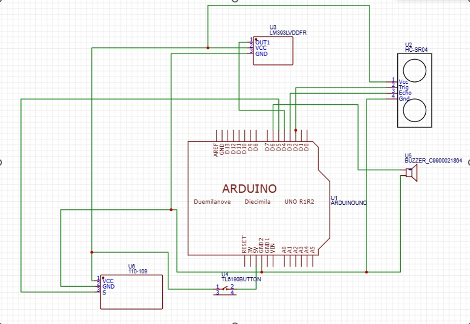
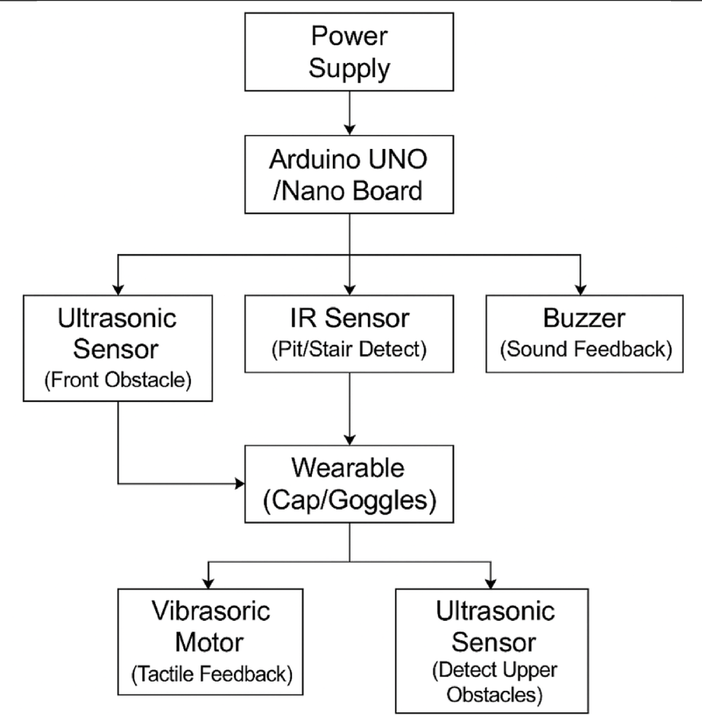
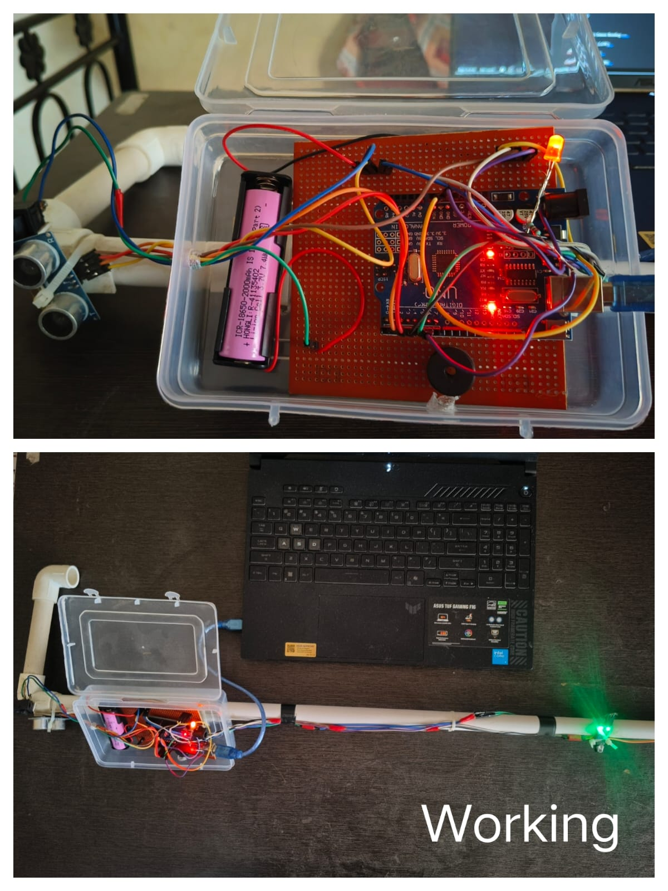
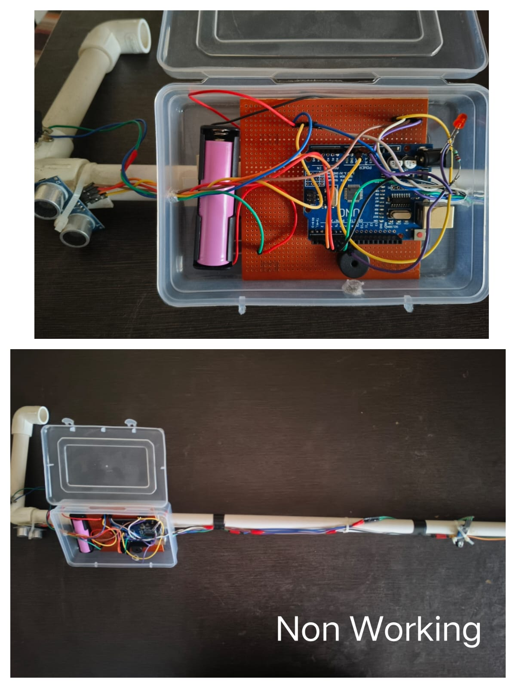

# 👁️ Vision Beyond Sight

## Smart Stick and Smart Cap for Visually Impaired People

An Arduino-based assistive technology project designed to help visually impaired people detect obstacles using ultrasonic and infrared sensors, audio alerts, and LED indicators.

---

## 📌 Project Overview

Vision Beyond Sight is a second-year engineering project that combines a smart stick and a smart cap to help users identify obstacles at different heights.

The system uses an Arduino Uno to process sensor readings and activate alerts when obstacles are detected.

## 🎯 Objectives

* Detect obstacles in front of the user.
* Provide audio alerts through a buzzer.
* Use LED indicators to communicate system status and obstacle detection.
* Explore an affordable assistive technology solution.

## 🧰 Hardware Components

* Arduino Uno
* HC-SR04 ultrasonic sensor
* IR sensor
* Buzzer
* Red LED
* Rechargeable battery
* Connecting wires
* Stick structure and wearable cap assembly

* 
## ⚙️ Working Principle

1. The ultrasonic sensor measures the distance to obstacles in front of the user.
2. The IR sensor provides additional obstacle-detection input.
3. The Arduino Uno processes the readings from both sensors.
4. When an obstacle is detected within the programmed range, the buzzer activates to alert the user.
5. A red LED serves as a visual working-status indicator, helping indicate whether the smart stick is operational.

## 🔌 Circuit Diagram

## 🧩 System Block Diagram

## 📸 Project Prototype

### Working Prototype

### Non-Working Prototype

## 💻 Arduino Source Code

The Arduino programs are available in the `code` folder:

* [Smart Stick Code](code/smart_stick.ino)
* [Smart Cap Code](code/smart_cap.ino)

Open either file to view the source code.

## 🚀 Future Improvements

* Voice-based obstacle alerts.
* GPS-based location assistance.
* Improved battery monitoring.
* More reliable obstacle detection.
* Improved wearable design and comfort.

